  

# 🚀 Awesome End-to-End API Workflow Testing

  
  
  
  
  
  

> 🌐 A curated directory of top SaaS platforms and open-source tools for End-to-End API workflow testing, multi-step orchestration, contract validation, and CI/CD test automation.

---

**End-to-End (E2E) API Workflow Testing** 🔄 validates complete business logic and data flows spanning sequential and asynchronous API interactions. Unlike isolated unit tests or single-endpoint smoke tests, workflow testing verifies state carryover, token generation and propagation, conditional branching, asynchronous polling (e.g., WebSockets, webhooks, message queues), database state assertions, and system reliability under load.

---

## 📑 Table of Contents

- [📊 Sector Overview & Market Dynamics](#-sector-overview--market-dynamics)
- [☁️ SaaS & Commercial Hosted Platforms](#️-saas--commercial-hosted-platforms)
- [💻 Open-Source GitHub Projects](#-open-source-github-projects)
- [🏗️ Key Architectural Approaches](#️-key-architectural-approaches)
- [📈 Star History](#-star-history)
- [💖 Support](#-support)
- [🤝 How to Contribute](#-how-to-contribute)
- [⚖️ Disclaimer](#️-disclaimer)

---

## 📊 Sector Overview & Market Dynamics

The global API testing market is valued at approximately **$1.64 Billion in 2025** and projected to exceed **$2.14 Billion by 2026** (expanding at an aggressive CAGR of ~21–23%). Rather than consolidating into a "winner-take-all" monopoly, the sector remains **highly fragmented and multi-layered**, driven by diverse architectural paradigms (microservices, event-driven systems, serverless, and multi-cloud protocols like REST, GraphQL, and gRPC) alongside a sharp divide between enterprise test-automation suites and local-first, developer-centric testing tools.

---

## ☁️ SaaS & Commercial Hosted Platforms

The following SaaS and enterprise platforms provide hosted test execution environments, orchestration dashboards, collaboration workspaces, and AI-assisted workflow generation.

| Product | 🏢 Company Scale (Valuation / Revenue) | 📝 Description | 💳 Starting Price | 🎁 Free Tier / Trial Limits |
|:---|:---|:---|:---|:---|
| **[Playwright](https://playwright.dev/)** (Microsoft) | **$3.1T+ Market Cap** | Microsoft's enterprise testing framework with optional managed cloud test execution (Microsoft Playwright Testing) for massive browser and API parallelism. | **$0.01/test minute** (Linux) / **$0.02/test minute** (Windows) | **Free core runner** (unlimited local/CI); **30-day trial** with 100 free cloud test minutes |
| **[Postman](https://www.postman.com/)** | **$5.6B Valuation** (~$170M+ ARR) | Ubiquitous API platform featuring Collection Runner, visual workflow Flows, mock servers, and centralized governance workspaces. | **$9/user/month** (Solo, billed annually) | **Free forever plan**: Single user only, unlimited local collection runs, 3 active Flows, 1,000 cloud calls/mo (no team collaboration) |
| **[Tricentis Tosca](https://www.tricentis.com/)** | **$4.5B Valuation** (~$500M ARR) | Enterprise model-based test automation suite for end-to-end API, web, and packaged application workflows across distributed environments. | **~$20,000/year** (Tosca Commander base platform) | **14-day free trial** (cloud-based trial including Agentic Test Automation; no perpetual free plan) |
| **[ReadyAPI](https://smartbear.com/product/ready-api/)** (SmartBear) | **~$2.0B Valuation** (~$500M Revenue) | SmartBear's enterprise API testing suite (successor to SoapUI Pro) specializing in complex transactional flows, security fuzzing, and virtualization. | **$749/user/year** (Starting functional tier) | **14-day free trial** (full access to test, perf, and virtualization modules; SoapUI Open Source remains separate free product) |
| **[Cypress Cloud](https://www.cypress.io/)** | **$255M Valuation** (~$20M ARR) | Hosted dashboard and execution engine providing smart orchestration, test replay, flake detection, and parallelization for Cypress test runs. | **$67/month** (Team tier, billed annually) | **Free forever plan**: Up to 10 users, 500 test results/month, test replay, and cloud parallelization |
| **[Katalon](https://katalon.com/)** | **$30M+ Funding** (~$36M–$60M ARR) | Integrated AI-augmented quality platform offering low-code and scriptable test authoring for cross-functional API, web, and mobile chains. | **$70/seat/month** (Platform tier) | **Free forever plan**: Katalon Studio Desktop Edition (local authoring/execution); **30-day trial** for cloud platform |
| **[Loadmill](https://www.loadmill.com/)** | **Early Stage / Private** (Funded by UpWest) | AI-powered workflow testing and synthetic load generator that automatically creates resilient multi-step API tests from user network traffic. | **$208/user/month** (Team Enablement plan) | **Free forever plan**: 50 max concurrency, 60 load test minutes, 100 API test flow runs/month |
| **[Speedscale](https://speedscale.com/)** | **$9M Funding** (Grotech, YC) | Traffic replay and synthetic API sandbox platform that mirrors real production traffic into mock environments to validate integrations. | **$0.01/MB ingested** (Platform SaaS) or $0.01/GB RAM (BYOC) | **Free forever for local dev**: proxymock utility is free forever for local traffic recording, mocking, and replay |
| **[Karate Labs](https://karatelabs.io/)** | **YC W22 Graduate** ($500K+ Seed) | Commercial developer tooling built on top of the open-source Karate framework, offering advanced IDE debugger plugins and async coverage. | **$640/user/year** (Pro license) | **Free forever**: Full MIT-licensed open-source framework with zero seat restrictions; **14-day trial** for Pro/Enterprise plugins |

---

## 💻 Open-Source GitHub Projects

These community-driven, open-source projects give engineering teams full control of their test suites, enabling local-first execution, git-managed test definitions, and zero per-seat licensing penalties in CI/CD pipelines.

| Project | ⭐ GitHub_Stars | 📝 Description | 🎯 Focus / Best For |
|:---|:---|:---|:---|
| **[Playwright](https://github.com/microsoft/playwright)** |  | Microsoft's high-speed end-to-end framework featuring unified API request contexts, network interception, auto-waiting, and multi-browser automation. | Modern web & full-stack API testing |
| **[Hoppscotch](https://github.com/hoppscotch/hoppscotch)** |  | Lightweight, self-hostable open-source API development and testing ecosystem supporting REST, GraphQL, and WebSocket streams. | Self-hosted team API workbench |
| **[Cypress](https://github.com/cypress-io/cypress)** |  | Developer-friendly test runner providing complete control over HTTP requests (`cy.request`), state cookies, and frontend-to-backend workflow chaining. | Combined UI + API workflow testing |
| **[Bruno](https://github.com/usebruno/bruno)** |  | Fast, local-first Postman alternative storing collections as plain-text files on disk directly inside your Git repositories. | Git-native collaborative API testing |
| **[HTTPie CLI](https://github.com/httpie/cli)** |  | Modern, human-readable command-line HTTP client with intuitive JSON syntax, persistent sessions, and shell-scripting automation support. | CLI smoke tests & shell workflow scripts |
| **[k6](https://github.com/grafana/k6)** |  | Grafana's modern, developer-centric load and workflow testing tool written in Go with JavaScript test scripting and metrics export. | API performance & workflow load tests |
| **[Locust](https://github.com/locustio/locust)** |  | Scalable, code-driven load and workflow testing framework where scenario orchestration and assertions are written in clean, idiomatic Python. | Python-centric multi-step load scenarios |
| **[Hurl](https://github.com/Orange-OpenSource/hurl)** |  | Plain-text HTTP test runner written in Rust that executes requests and validates response headers, JSONPath, and XPath queries in CI. | Declarative text-based CI/CD testing |
| **[Artillery](https://github.com/artilleryio/artillery)** |  | Cloud-native, distributed load and API workflow testing platform for REST, GraphQL, WebSocket, and asynchronous event streams. | Distributed workflow & traffic stress testing |
| **[Karate](https://github.com/karatelabs/karate)** |  | All-in-one testing framework combining API testing, mocks, performance testing (Gatling), and UI automation into a single BDD syntax. | Unified multi-protocol acceptance testing |
| **[WireMock](https://github.com/wiremock/wiremock)** |  | Flexible library and standalone server for HTTP service virtualization, fault injection, dynamic response templating, and stateful verification. | Stateful downstream API mocking & isolation |
| **[REST Assured](https://github.com/rest-assured/rest-assured)** |  | Java standard library for Given-When-Then REST validation with seamless integration into JUnit, TestNG, and Maven/Gradle CI pipelines. | Enterprise Java / Spring backend testing |
| **[MockServer](https://github.com/mock-server/mockserver)** |  | Comprehensive mocking and proxy server enabling verification of requests, TLS inspection, and expectation matching across multi-service workflows. | Integration mocking & traffic verification |
| **[HttpRunner](https://github.com/httprunner/httprunner)** |  | Unified API/UI test framework powered by Go and Python, supporting HAR recording, YAML/JSON test definitions, and distributed execution. | Declarative YAML-based API pipelines |
| **[Step CI](https://github.com/stepci/stepci)** |  | Declarative, CI-native API test automation tool supporting REST, GraphQL, and gRPC with built-in security fuzzing and load assertions. | CI-native declarative contract & load checks |
| **[PactumJS](https://github.com/pactumjs/pactum)** |  | Fast, lightweight REST API test automation library for Node.js with built-in data-spec mocking, contract testing, and workflow step chaining. | Node.js / TypeScript microservice validation |

---

## 🏗️ Key Architectural Approaches

When choosing an end-to-end API workflow testing tool, teams generally select between three core architectural models:

1. **📁 Local-First & Git-Native (e.g., Bruno, Hurl, HTTPie, Step CI):**
   - Test collections and environment definitions live alongside source code in version control.
   - Eliminates vendor lock-in, proprietary cloud sync, and per-seat fees.
   - Simplifies pull request validation in GitHub Actions, GitLab CI, and CircleCI.

2. **🧰 Unified Full-Stack Frameworks (e.g., Karate, Playwright, Cypress):**
   - Consolidates API calls, UI interactions, database queries, and mocking into a cohesive test suite.
   - Prevents context switching and minimizes code duplication across frontend and backend QA workflows.

3. **☁️ Enterprise Test Cloud & Service Virtualization (e.g., Tricentis, SmartBear ReadyAPI, Postman, WireMock):**
   - Ideal for large organizations managing complex compliance policies, legacy SOAP/mainframe endpoints, and third-party API rate limits.
   - Enables service virtualization and fault-injection to safely simulate third-party dependency outages.

---

## 📈 Star History

---

## 💖 Support

Thank you for visiting and using this curated ecosystem guide! If you find this repository valuable:

- ⭐ **Star this repository** to help others discover it!
- 🍴 **Fork and contribute** your favorite API workflow testing tools and improvements!
- 📢 **Share with your network**—colleagues, QA engineers, and developer communities!
- ☕ **Buy a coffee / Sponsor**: If this project saves your engineering team time or money, consider supporting continued maintenance via the [GitHub Sponsor Dashboard](https://github.com/sponsors/ishandutta2007).

---

## 🤝 How to Contribute

1. 🍴 Fork this repository.
2. ✍️ Add your tool to the appropriate table maintaining strict alphabetical or descending ranking order.
3. 🔍 Ensure all links, descriptions, pricing tiers, and GitHub stargazer badges are factual and verifiable.
4. 🚀 Submit a pull request with a concise description of the addition.

---

## ⚖️ Disclaimer

- 📌 This list is **community-curated** for educational and architectural evaluation purposes.
- 🏷️ Pricing, free tiers, and valuations are accurate as of early 2026 and subject to change by respective vendors.
- 🛡️ Executing end-to-end API tests against staging or production systems can mutate persistent database state; ensure idempotent test designs and isolated test environments.
